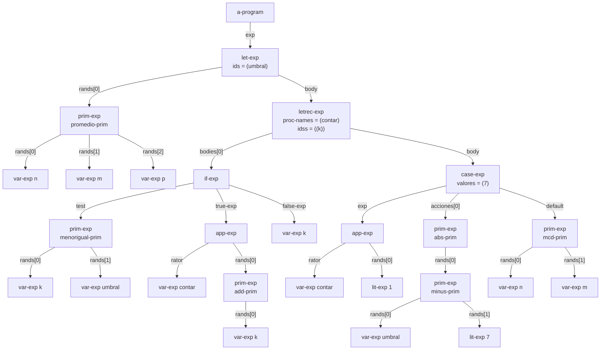
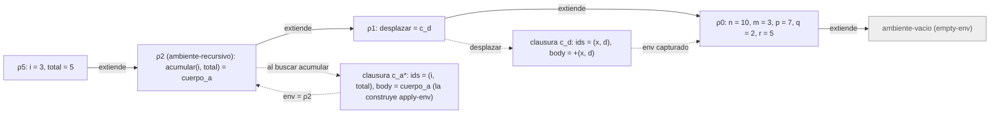

# Informe de AST — Taller 2: El intérprete de Cauca

> **Plantilla de entrega.** Copie este archivo a `docs/informe-ast.md`
> dentro del repositorio del grupo y reemplace los marcadores
> `{{...}}` con su contenido. **No elimine las secciones
> obligatorias.** No se aceptan PDF, DOCX ni imágenes insertadas:
> todo el documento debe ser Markdown, las fórmulas en LaTeX
> (`$...$` / `$$...$$`) y los diagramas en Mermaid.

**Curso:** Fundamentos de Interpretación y Compilación de Lenguajes
de Programación — Universidad del Valle, Sede Tuluá.

**Integrantes del grupo:**

| Nombre completo | Código | Correo institucional |
|---|---|---|
| Andres Felipe Quiceno Gil | 2477362 | quiceno.andres@correounivalle.edu.co |
| Yonier Alejandro Vega Rojas | 2477056 | yonier.vega@correounivalle.edu.co |
| Jhon Fabricio Hurtado Marin | 2459472 | hurtado.jhoan@correounivalle.edu.co |
| Juan Esteban Aguirre Castañeda | 2459676 | juan.esteban.aguirre@correounivalle.edu.co |

---

> Los resultados de este informe se comprobaron ejecutando el intérprete: el programa del Ejemplo 1 devuelve `1/3` y el de la traza devuelve `8`.

## 1. Gramática considerada
 
Gramática de Cauca (base, Partes 2, 3 y 4). Cada producción indica el constructor del AST que genera `sllgen:make-define-datatypes`.
 
```bnf
<programa>   ::= <expresion>                                   a-program(exp)
 
<expresion>  ::= <numero>                                      lit-exp(dato)
             ::= <identificador>                               var-exp(id)
             ::= "true"                                        true-exp()
             ::= "false"                                       false-exp()
             ::= <primitiva> "(" {<expresion>}*(,) ")"         prim-exp(prim, rands)
             ::= "if" <expresion> "then" <expresion>
                 "else" <expresion> "end"                      if-exp(test, true-exp, false-exp)
             ::= "let" {<identificador> "=" <expresion>}*
                 "in" <expresion> "end"                        let-exp(ids, rands, body)
             ::= "proc" "(" {<identificador>}*(,) ")"
                 <expresion> "end"                             proc-exp(ids, body)
             ::= "apply" <expresion>
                 "(" {<expresion>}*(,) ")"                     app-exp(rator, rands)
             ::= "letrec" {<identificador> "(" {<identificador>}*(,) ")"
                 "=" <expresion>}* "in" <expresion> "end"      letrec-exp(proc-names, idss, bodies, body)
             ::= "case" <expresion>
                 {"of" <numero> "=>" <expresion>}*
                 "otherwise" "=>" <expresion> "end"            case-exp(exp, valores, acciones, default)
 
<primitiva>  ::= "+" sum-prim() | "-" minus-prim() | "*" mult-prim() | "/" div-prim()
             |   "add1" add-prim() | "sub1" sub-prim()
             |   ">" mayor-prim() | ">=" mayorigual-prim() | "<" menor-prim() | "<=" menorigual-prim()
             |   "==" igual-prim() | "not" not-prim() | "and" and-prim() | "or" or-prim()
             |   "abs" abs-prim() | "mcd" mcd-prim() | "mcm" mcm-prim() | "promedio" promedio-prim()
             |   "xor" xor-prim() | "implica" implica-prim() | "entre" entre-prim()
```
 
Nota: `case` se declaró con `arbno` (cero o más ramas `of`), porque SLLGEN no tiene operador `+`.
 
---
 
## 2. Ejemplos de AST
 
### Ejemplo 1 — Programa del enunciado (`let` + `letrec` + `case`)
 
**Expresión concreta:**
 
```scheme
let umbral = promedio(n, m, p)
in
  letrec
    contar (k) = if <=(k, umbral)
                 then apply contar (add1(k))
                 else k
                 end
  in
    case apply contar (1)
      of 7 => abs(-(umbral, 7))
      otherwise => mcd(n, m)
    end
  end
end
```
 
**Término del AST** (salida real de `parser`):
 
```racket
(a-program
 (let-exp '(umbral)
          (list (prim-exp (promedio-prim)
                          (list (var-exp 'n) (var-exp 'm) (var-exp 'p))))
          (letrec-exp '(contar) '((k))
                      (list (if-exp (prim-exp (menorigual-prim)
                                              (list (var-exp 'k) (var-exp 'umbral)))
                                    (app-exp (var-exp 'contar)
                                             (list (prim-exp (add-prim) (list (var-exp 'k)))))
                                    (var-exp 'k)))
                      (case-exp (app-exp (var-exp 'contar) (list (lit-exp 1)))
                                '(7)
                                (list (prim-exp (abs-prim)
                                                (list (prim-exp (minus-prim)
                                                                (list (var-exp 'umbral) (lit-exp 7))))))
                                (prim-exp (mcd-prim) (list (var-exp 'n) (var-exp 'm)))))))
```
 
**AST:** cada nodo lleva el nombre del constructor; en `prim-exp` se indica entre paréntesis la primitiva, y las aristas llevan el nombre del campo.
 

 
**Explicación.**
 
| Nodo | Campos |
|---|---|
| `let-exp` | `ids = (umbral)`, un rand (`promedio(n, m, p)`), cuerpo = `letrec-exp` |
| `letrec-exp` | `proc-names = (contar)`, `idss = ((k))`, un cuerpo (`if-exp`), cuerpo = `case-exp` |
| `if-exp` | `test = <=(k, umbral)`, `true-exp = apply contar (add1(k))`, `false-exp = k` |
| `case-exp` | control = `apply contar (1)`, `valores = (7)`, una acción (`abs(-(umbral, 7))`), `default = mcd(n, m)` |
 
**Resultado de la evaluación.** El ambiente inicial es $n=10,\ m=3,\ p=7,\ q=2,\ r=5$, así que
 
$$\text{umbral} = \text{promedio}(10, 3, 7) = \tfrac{20}{3} \approx 6{,}67 .$$
 
`contar` sube $k$ de a uno mientras $k \le \tfrac{20}{3}$; se detiene en $k = 7$. Como el control del `case` vale $7$, se toma la rama `of 7`:
 
$$\text{abs}\!\left(\tfrac{20}{3} - 7\right) = \text{abs}\!\left(-\tfrac{1}{3}\right) = \tfrac{1}{3}.$$
 
---
 
## 3. Traza de evaluación
 
**Expresión a evaluar:**
 
```scheme
let desplazar = proc (x, d) +(x, d) end
in
  letrec
    acumular (i, total) = if >(i, m)
                          then total
                          else apply acumular
                                 (add1(i), apply desplazar (total, i))
                          end
  in
    apply acumular (1, q)
  end
end
```
 
**Ambiente inicial:** $\rho_0 = [\,n = 10,\ m = 3,\ p = 7,\ q = 2,\ r = 5\,]$.
 
### Notación
 
Se usa la notación de EOPL: $\text{value-of}(exp, \rho) = val$. Los ambientes se escriben `[ x = v1, y = v2, ... ]`, con la ligadura más reciente a la izquierda.
 
- `c_d` es la clausura de `desplazar`: $\langle (x, d),\ \texttt{+(x, d)},\ \rho_0 \rangle$. Captura $\rho_0$, el ambiente donde se evaluó el `proc`.
- `c_a*` es la clausura de `acumular`: $\langle (i, total),\ \text{cuerpo}_a,\ \rho_2 \rangle$. **No está guardada en el ambiente**: `apply-env` la construye cada vez que encuentra el nombre en el `ambiente-recursivo`, entregándole el propio $\rho_2$. El asterisco la marca.
- `cuerpo_a` es el `if` completo del procedimiento `acumular`.
### Ambientes que intervienen
 
| Ambiente | Contenido | Variante |
|---|---|---|
| $\rho_0$ | `[ n = 10, m = 3, p = 7, q = 2, r = 5 ]` | `ambiente-extendido` sobre `ambiente-vacio` |
| $\rho_1$ | `[ desplazar = c_d, n = 10, m = 3, p = 7, q = 2, r = 5 ]` | `ambiente-extendido` sobre $\rho_0$ |
| $\rho_2$ | `[ acumular = c_a*, desplazar = c_d, n = 10, m = 3, p = 7, q = 2, r = 5 ]` | `ambiente-recursivo` sobre $\rho_1$ |
| $\rho_3$ | `[ i = 1, total = 2, acumular = c_a*, desplazar = c_d, n = 10, m = 3, p = 7, q = 2, r = 5 ]` | `ambiente-extendido` sobre $\rho_2$ |
| $\rho_4$ | `[ i = 2, total = 3, acumular = c_a*, desplazar = c_d, n = 10, m = 3, p = 7, q = 2, r = 5 ]` | `ambiente-extendido` sobre $\rho_2$ |
| $\rho_5$ | `[ i = 3, total = 5, acumular = c_a*, desplazar = c_d, n = 10, m = 3, p = 7, q = 2, r = 5 ]` | `ambiente-extendido` sobre $\rho_2$ |
| $\rho_6$ | `[ i = 4, total = 8, acumular = c_a*, desplazar = c_d, n = 10, m = 3, p = 7, q = 2, r = 5 ]` | `ambiente-extendido` sobre $\rho_2$ |
| $\rho_{d1}$ | `[ x = 2, d = 1, n = 10, m = 3, p = 7, q = 2, r = 5 ]` | `ambiente-extendido` sobre $\rho_0$ (el de `c_d`) |
| $\rho_{d2}$ | `[ x = 3, d = 2, n = 10, m = 3, p = 7, q = 2, r = 5 ]` | `ambiente-extendido` sobre $\rho_0$ |
| $\rho_{d3}$ | `[ x = 5, d = 3, n = 10, m = 3, p = 7, q = 2, r = 5 ]` | `ambiente-extendido` sobre $\rho_0$ |
 
Los cuerpos de `desplazar` se evalúan sobre $\rho_0$ y no sobre $\rho_3$, $\rho_4$ ni $\rho_5$: esa es la clausura en acción.
 
### Traza paso a paso
 
Las llamadas a `acumular` son: la **inicial** (paso 8, ambiente $\rho_3$), la **primera llamada recursiva** (paso 15, $\rho_4$) y la **segunda llamada recursiva** (paso 18, $\rho_5$).
 
| # | Expresión que se evalúa | Ambiente en el que se evalúa | Resultado |
|---|---|---|---|
| 1 | `let desplazar = proc (x, d) +(x, d) end in letrec … end` | `[ n = 10, m = 3, p = 7, q = 2, r = 5 ]` ($\rho_0$) | se obtiene del paso 3 (queda 8) |
| 2 | `proc (x, d) +(x, d) end` (el rand del `let`) | `[ n = 10, m = 3, p = 7, q = 2, r = 5 ]` ($\rho_0$) | `c_d = ⟨(x, d), +(x, d), ρ0⟩`; el cuerpo no se evalúa |
| 3 | `letrec acumular … in apply acumular (1, q) end` (cuerpo del `let`, con $\rho_1$ = $\rho_0$ extendido con `desplazar`) | `[ desplazar = c_d, n = 10, m = 3, p = 7, q = 2, r = 5 ]` ($\rho_1$) | evalúa su cuerpo en $\rho_2$ (queda 8) |
| 4 | `apply acumular (1, q)` | `[ acumular = c_a*, desplazar = c_d, n = 10, m = 3, p = 7, q = 2, r = 5 ]` ($\rho_2$) | se obtiene de los pasos 5 a 8 |
| 5 | `acumular` (operador) | $\rho_2$ (el de arriba) | `apply-env` halla `acumular` en el `ambiente-recursivo` y construye `c_a* = ⟨(i, total), cuerpo_a, ρ2⟩` |
| 6 | `1` (primer rand) | $\rho_2$ | `1` |
| 7 | `q` (segundo rand) | $\rho_2$ | `2`: no está en $\rho_2$ ni en $\rho_1$, se halla en $\rho_0$ |
| 8 | `apply-procedure(c_a*, (1, 2))`: evalúa `cuerpo_a` | `[ i = 1, total = 2, acumular = c_a*, desplazar = c_d, n = 10, m = 3, p = 7, q = 2, r = 5 ]` ($\rho_3$) | se obtiene de los pasos 9 a 14 y 15 |
| 9 | `>(i, m)` (test del `if`) | $\rho_3$ | `>(1, 3) = #f`, se evalúa la rama `else` |
| 10 | `apply acumular (add1(i), apply desplazar (total, i))` | $\rho_3$ | se obtiene de los pasos 11 a 15 |
| 11 | `acumular` (operador) | $\rho_3$ | `c_a*` (`i` y `total` no coinciden; se halla en el ambiente recursivo) |
| 12 | `add1(i)` | $\rho_3$ | `add1(1) = 2` |
| 13 | `apply desplazar (total, i)`: operador `desplazar` → `c_d`; rands `total` → `2`, `i` → `1` | $\rho_3$ | se aplica `c_d` a `(2, 1)` |
| 14 | `apply-procedure(c_d, (2, 1))`: evalúa `+(x, d)` | `[ x = 2, d = 1, n = 10, m = 3, p = 7, q = 2, r = 5 ]` ($\rho_{d1}$) | `+(2, 1) = 3` |
| 15 | `apply-procedure(c_a*, (2, 3))` (**primera llamada recursiva**): evalúa `cuerpo_a` | `[ i = 2, total = 3, acumular = c_a*, desplazar = c_d, n = 10, m = 3, p = 7, q = 2, r = 5 ]` ($\rho_4$) | se obtiene de los pasos 16 a 18 |
| 16 | `>(i, m)` | $\rho_4$ | `>(2, 3) = #f`, rama `else` |
| 17 | rands: `add1(i)` y `apply desplazar (total, i)` | $\rho_4$ | `add1(2) = 3`; `c_d` aplicada a `(3, 2)` en `[ x = 3, d = 2, n = 10, m = 3, p = 7, q = 2, r = 5 ]` ($\rho_{d2}$) da `+(3, 2) = 5` |
| 18 | `apply-procedure(c_a*, (3, 5))` (**segunda llamada recursiva**): evalúa `cuerpo_a` | `[ i = 3, total = 5, acumular = c_a*, desplazar = c_d, n = 10, m = 3, p = 7, q = 2, r = 5 ]` ($\rho_5$) | se obtiene de los pasos 19 a 21 |
| 19 | `>(i, m)` | $\rho_5$ | `>(3, 3) = #f`, rama `else` |
| 20 | rands: `add1(i)` y `apply desplazar (total, i)` | $\rho_5$ | `add1(3) = 4`; `c_d` aplicada a `(5, 3)` en `[ x = 5, d = 3, n = 10, m = 3, p = 7, q = 2, r = 5 ]` ($\rho_{d3}$) da `+(5, 3) = 8` |
| 21 | `apply-procedure(c_a*, (4, 8))` (tercera llamada recursiva): evalúa `cuerpo_a` | `[ i = 4, total = 8, acumular = c_a*, desplazar = c_d, n = 10, m = 3, p = 7, q = 2, r = 5 ]` ($\rho_6$) | se obtiene de los pasos 22 y 23 |
| 22 | `>(i, m)` | $\rho_6$ | `>(4, 3) = #t`, rama `then` |
| 23 | `total` (rama `then`) | $\rho_6$ | `8` |
 
Al retornar, cada `if-exp` y cada `app-exp` pendiente devuelve el mismo valor, porque la llamada recursiva está en posición de cola. Por lo tanto:
 
$$\text{value-of}(\texttt{let desplazar = … end},\ \rho_0) = 8 .$$
 
Comprobación independiente: $\text{total} = q + 1 + 2 + 3 = 2 + 6 = 8$.
 
### Diagrama de la cadena de ambientes (segunda llamada recursiva)
 
El diagrama corresponde al momento en que se evalúa `cuerpo_a` de la **segunda llamada recursiva**, `acumular(3, 5)` (paso 18), cuyo ambiente es $\rho_5$.
 
Las flechas continuas van del ambiente que extiende hacia el ambiente extendido. Las flechas punteadas muestran dónde está guardada la clausura de `desplazar` y qué ambiente captura. `c_a*` aparece también punteada: se construye en el momento de la búsqueda y apunta a $\rho_2$.
 

 
**Lectura.**
 
1. La cadena es $\rho_5 \to \rho_2 \to \rho_1 \to \rho_0 \to \text{ambiente-vacio}$.
2. `c_d` captura $\rho_0$, que es el ambiente vigente cuando se evaluó `proc (x, d) …`. Cuando se aplica `desplazar`, su cuerpo se evalúa en $[x = \ldots, d = \ldots]$ sobre $\rho_0$, nunca sobre $\rho_5$.
3. `c_a*` captura $\rho_2$, el propio `ambiente-recursivo`. Por eso dentro del cuerpo de `acumular` el nombre `acumular` siempre se resuelve: se busca en $\rho_5$ (no está), luego en $\rho_2$, donde se vuelve a construir la clausura.
4. `ambiente-vacio` cierra la cadena. Si un nombre no aparece en ninguno de los cuatro ambientes de arriba, `apply-env` llega a él y levanta error de variable no ligada.
---
 
## 4. Estado del almacén en una transacción
 
No aplica: Cauca no tiene almacén ni bloques transaccionales, y el enunciado del Taller 2 no pide este diagrama.
 
---
 
## 5. Referencias
 
- Friedman, D. P., & Wand, M. *Essentials of Programming Languages*, 3.ª ed., MIT Press, 2008. Secciones 2.2 y 2.5 (tipos de datos y AST), 3.2 (el lenguaje LET), 3.3 (procedimientos y clausuras, Figura 3.7) y 3.4 (procedimientos recursivos, Figura 3.9).
- The Racket Guide, *Parsing with SLLGEN*, documentación del lenguaje `eopl`.
