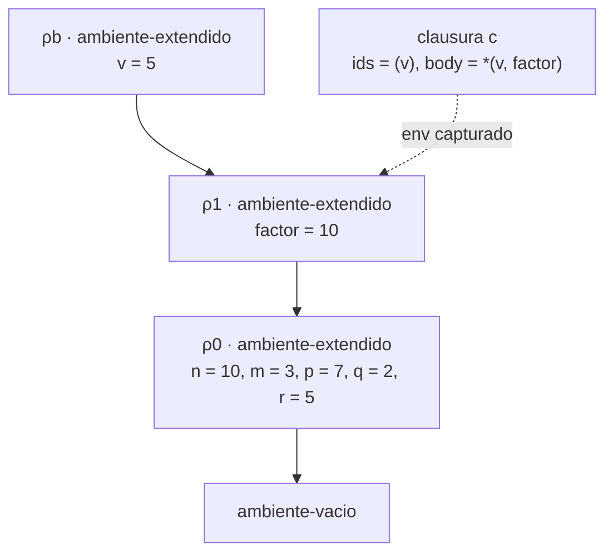
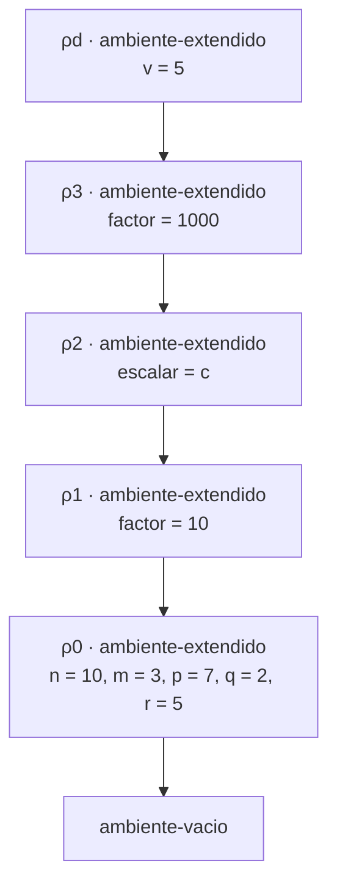

# Informe de corrección — Taller 2: El intérprete de Cauca
 
**Curso:** Fundamentos de Interpretación y Compilación de Lenguajes
de Programación — Universidad del Valle, Sede Tuluá.

**Integrantes del grupo:**

| Nombre completo | Código | Correo institucional |
|---|---|---|
| Andres Felipe Quiceno Gil | 2477362 | quiceno.andres@correounivalle.edu.co |
| Yonier Alejandro Vega Rojas | 2477056 | yonier.vega@correounivalle.edu.co |
| Jhon Fabricio Hurtado Marin | 2459472 | hurtado.jhoan@correounivalle.edu.co |
| Juan Esteban Aguirre Castañeda | 2459676 | juan.esteban.aguirre@correounivalle.edu.co |

---

> Los resultados citados se comprobaron ejecutando el intérprete: el ejemplo de contraste da 50, `potencia(2, 10)` da 1024 y la versión con `let` de `fact` falla con `Variable no ligada: fact`. El valor 5000 es el que se obtendría con alcance dinámico y se calcula solo para el contraste.
 
## 1. Marco formal
 
### 1.1 Corrección de programas recursivos
 
Sea $f : A \to B$ una función y $A$ un conjunto definido recursivamente. Sea $P_f$ un programa recursivo en Racket que pretende calcular $f$. Decimos que $P_f$ es correcto con respecto a su especificación si se cumple:
 
$$
\forall a \in A \,:\, P_f(a) = f(a)
$$
 
La estrategia de demostración es la **inducción estructural** sobre $A$:
 
- **Caso base:** para cada valor básico $a_0 \in A$ se verifica $P_f(a_0) = f(a_0)$.
- **Caso inductivo:** asumiendo la **hipótesis de inducción** $P_f(a') = f(a')$ para las subestructuras $a'$ que forman $a$, se demuestra $P_f(a) = f(a)$.
En este informe esta estrategia se usa para `evaluar-caso` (inducción sobre la lista de ramas) y para `buscar-proc-recursivo` y `potencia` (inducción sobre la lista de nombres y sobre $\text{exp}$).
 
### 1.2 Corrección de programas iterativos
 
Para un programa iterativo se formalizan un estado $s$, un estado inicial $s_0$, un predicado $\text{es-final?}(s)$, una **invariante** $\text{Inv}(s)$ y una transformación $\text{transformar}(s)$. La corrección se argumenta demostrando:
 
1. $\text{Inv}(s_0)$ se cumple al inicio.
2. $\text{Inv}(s) \,\land\, \lnot\text{es-final?}(s)\Rightarrow \text{Inv}(\text{transformar}(s))$.
3. $\text{Inv}(s) \,\land\, \text{es-final?}(s)\Rightarrow \text{respuesta}(s) = f(\text{entrada})$.
4. El proceso termina (cota estrictamente decreciente sobre $\mathbb{N}$).
Para `letrec` se enuncia como invariante una propiedad del ambiente (sección 2.2), que se conserva en cada llamada, y se demuestra su terminación con una medida sobre $\mathbb{N}$.
 
### 1.3 Notación y reglas semánticas de Cauca
 
$\rho, \sigma$ denotan ambientes. $\vec{x} = (x_1,\dots,x_n)$ y $\vec{v} = (v_1,\dots,v_n)$ denotan listas de identificadores y de valores. $\text{ext}(\vec{x},\vec{v},\sigma)$ es `ambiente-extendido` y $\text{rec}(F,X,B,\sigma)$ es `ambiente-recursivo`, con $F = (f_1,\dots,f_k)$ los nombres, $X = (\vec{x}_1,\dots,\vec{x}_k)$ las listas de parámetros y $B = (b_1,\dots,b_k)$ los cuerpos. Escribimos $\langle \vec{x}, b, \sigma\rangle$ para `cerradura`$(\vec{x}, b, \sigma)$.
 
**Búsqueda (`apply-env`).** Es la traducción directa del código de `src/ambiente.rkt`:
 
$$
\begin{aligned}
(\text{E1})\quad & \text{apply-env}(\text{vacio}, y) = \text{error}\\
(\text{E2})\quad & \text{apply-env}(\text{ext}(\vec{x},\vec{v},\sigma), y) =
\begin{cases} v_i & \text{si } i \text{ es el menor índice con } x_i = y\\ \text{apply-env}(\sigma, y) & \text{si } y \notin \vec{x}\end{cases}\\
(\text{E3})\quad & \text{apply-env}(\text{rec}(F,X,B,\sigma), y) =
\begin{cases} \langle \vec{x}_i,\, b_i,\, \text{rec}(F,X,B,\sigma)\rangle & \text{si } i \text{ es el menor índice con } f_i = y\\ \text{apply-env}(\sigma, y) & \text{si } y \notin F\end{cases}
\end{aligned}
$$
 
**Semántica (`evaluar-expresion` y `apply-procedure`).**
 
$$
\begin{aligned}
(\text{S-proc})\quad & \text{value-of}(\texttt{proc}(\vec{x})\ b,\ \rho) = \langle \vec{x},\, b,\, \rho\rangle\\
(\text{S-let})\quad & \text{value-of}(\texttt{let}\ \vec{x}=\vec{e}\ \texttt{in}\ b,\ \rho) = \text{value-of}(b,\ \text{ext}(\vec{x},\vec{v},\rho)),\quad v_j = \text{value-of}(e_j,\rho)\\
(\text{S-letrec})\quad & \text{value-of}(\texttt{letrec}\ F(X)=B\ \texttt{in}\ b,\ \rho) = \text{value-of}(b,\ \text{rec}(F,X,B,\rho))\\
(\text{S-app})\quad & \text{value-of}(\texttt{apply}\ e_0\,(e_1,\dots,e_n),\ \rho):\ f = \text{value-of}(e_0,\rho);\\
& \quad \text{si } \neg\,\text{procval?}(f) \text{ entonces error; si no, } v_j = \text{value-of}(e_j,\rho) \text{ y se evalúa } \text{apply-procedure}(f,\vec{v})\\
(\text{S-ap})\quad & \text{apply-procedure}(\langle \vec{x}, b, \sigma\rangle,\ \vec{v}) = \begin{cases}\text{value-of}(b,\ \text{ext}(\vec{x},\vec{v},\sigma)) & \text{si } |\vec{x}| = |\vec{v}|\\ \text{error} & \text{si } |\vec{x}| \neq |\vec{v}|\end{cases}
\end{aligned}
$$
 
**Hipótesis comunes.** (H1) Los parámetros de un mismo procedimiento son distintos entre sí; si se repitieran, (E2) elige el de menor índice. (H2) Cuando se habla de "error de la regla" se excluyen los errores que provienen de evaluar subexpresiones (variable no ligada, tipo incorrecto en una primitiva, etc.), que simplemente se propagan.
 
---
 
## 2. Funciones analizadas
 
### 2.1 Corrección de `apply-procedure` (y de `app-exp`)
 
**Especificación.**
 
- **Tipo:** `apply-procedure : procval × lista-de-valores -> valor`
- **Pre-condición.** $\text{Pre}$: $c = \langle \vec{x}, b, \sigma\rangle$ es una clausura (`procval?`$(c)$), $\vec{v}$ es una lista de valores expresados, $|\vec{x}| = |\vec{v}|$, y $\sigma$ es un ambiente bien formado (una cadena finita de ambientes que termina en `ambiente-vacio`).
- **Post-condición.** $\text{Post}$: si la evaluación de $b$ en $\text{ext}(\vec{x},\vec{v},\sigma)$ termina con valor $w$, entonces
$$
\text{apply-procedure}(c, \vec{v}) = w = \text{value-of}\big(b,\ \text{ext}(\vec{x},\vec{v},\sigma)\big),
$$
 
y el ambiente de la llamada (donde se escribió `apply`) no interviene en el cálculo de $w$.
 
- **Fuera de la pre-condición** ($|\vec{x}| \neq |\vec{v}|$), la post-condición es: se levanta `eopl:error` y no se evalúa $b$.
**Código.**
 
```racket
; apply-procedure : procval x lista-de-valores -> valor
; Propósito: evalúa el cuerpo de la clausura en el ambiente de la clausura
;            extendido con los parámetros; error si la aridad no coincide.
(define apply-procedure
  (lambda (proc args)
    (cases procval proc
      (cerradura (ids body env-claustura)
        (if (= (length ids) (length args))
            (evaluar-expresion body (ambiente-extendido ids args env-claustura))
            (eopl:error 'apply-procedure "Cantidad incorrecta de argumentos ..."))))))
 
;; en evaluar-expresion:
(proc-exp (ids body) (cerradura ids body env))
(app-exp (rator rands)
  (let ((proc (evaluar-expresion rator env)))
    (if (procval? proc)
        (let ((args (evaluar-rands rands env)))
          (apply-procedure proc args))
        (eopl:error 'evaluar-expresion "El operador de apply debe ser un procedimiento ..."))))
```
 
**Estrategia de demostración:** análisis directo del código sobre las reglas (S-proc), (S-app) y (S-ap), apoyado en un lema de captura; contraste entre las dos cadenas de ambientes del ejemplo de la Parte 3, y análisis exhaustivo de casos para los errores.
 
**Demostración.**
 
#### El cuerpo se evalúa en el ambiente de la clausura, no en el de la llamada
 
**Lema 1 (la clausura captura el ambiente de definición).** Si `proc-exp`$(\vec{x}, b)$ se evalúa en $\rho$, el resultado es $\langle \vec{x}, b, \rho\rangle$.
 
*Demostración.* Es la regla (S-proc): la rama `proc-exp` de `evaluar-expresion` retorna `(cerradura ids body env)`, donde `env` es el parámetro de `evaluar-expresion`, es decir, el ambiente en el que se evalúa el `proc`. El cuerpo `body` se guarda tal cual, sin evaluarlo. $\square$
 
**Teorema 2.** Para toda aplicación $\text{apply-procedure}(\langle\vec{x}, b, \sigma\rangle, \vec{v})$ con $|\vec{x}| = |\vec{v}|$, el cuerpo se evalúa en $\text{ext}(\vec{x}, \vec{v}, \sigma)$, donde $\sigma$ es el ambiente de definición dado por el Lema 1, y no en el ambiente de la llamada $\rho_{\text{llamada}}$.
 
*Demostración.* En la rama `cerradura` de `apply-procedure`, el ambiente que recibe `evaluar-expresion` es `(ambiente-extendido ids args env-claustura)`. Los tres componentes salen de la clausura (`ids`, `env-claustura`) o de la lista de valores (`args`). La función `apply-procedure` tiene como únicos parámetros `proc` y `args`: **el ambiente de la llamada no es un parámetro suyo**, así que no hay forma de que influya en el ambiente donde se evalúa el cuerpo. Por (S-ap), el ambiente es exactamente $\text{ext}(\vec{x},\vec{v},\sigma)$. $\square$
 
#### Contraste con el ejemplo de la Parte 3
 
```
let factor = 10
in
  let escalar = proc (v) *(v, factor) end
  in
    let factor = 1000
    in
      apply escalar (5)
    end
  end
end
```
 
Los ambientes son:
 
- $\rho_0 = [\,n=10,\ m=3,\ p=7,\ q=2,\ r=5\,]$
- $\rho_1 = [\,\text{factor}=10\,]\ \text{sobre}\ \rho_0$
- $c = \langle (v),\ \texttt{*(v, factor)},\ \rho_1\rangle$ (Lema 1: el `proc` se evaluó en $\rho_1$)
- $\rho_2 = [\,\text{escalar}=c\,]\ \text{sobre}\ \rho_1$
- $\rho_3 = [\,\text{factor}=1000\,]\ \text{sobre}\ \rho_2$ — **este es el ambiente de la llamada**.
**Cadena que produce 50 (ambiente de la clausura, la que implementa el intérprete).** El cuerpo se evalúa en $\rho_b = [\,v=5\,]$ sobre $\rho_1$. Se busca `factor`: no es `v`, se halla `factor = 10` en $\rho_1$:
 

 
$$\text{value-of}(\texttt{*(v, factor)},\ \rho_b) = 5 \cdot 10 = \mathbf{50}.$$
 
**Cadena que produciría 5000 (ambiente de la llamada, el error que la clausura evita).** El cuerpo se evaluaría en $\rho_d = [\,v=5\,]$ sobre $\rho_3$. Se busca `factor`: no es `v`, y lo primero que se encuentra es `factor = 1000` de $\rho_3$:
 

 
$$\text{value-of}(\texttt{*(v, factor)},\ \rho_d) = 5 \cdot 1000 = \mathbf{5000}.$$
 
Por el Teorema 2 el intérprete usa la primera cadena, y el programa devuelve $50$ (comprobado ejecutándolo). La diferencia es que $\rho_3$ (el `let` interno que liga `factor = 1000`) queda fuera de la cadena de la clausura: $\rho_1$ no es extensión de $\rho_3$.
 
#### Errores exactamente cuando el operador no es procedimiento o la aridad no coincide
 
**Teorema 3.** Sea $f = \text{value-of}(e_0, \rho)$ y $\vec{v} = \text{value-of}(\vec{e}, \rho)$, ambos sin error (H2). La regla de aplicación levanta un error propio **si y solo si** $\neg\,\text{procval?}(f)$ **o** $|\vec{x}| \neq |\vec{v}|$, donde $f = \langle\vec{x}, b, \sigma\rangle$.
 
*Demostración.* Por análisis de casos sobre el código.
 
- *Caso $\neg\,\text{procval?}(f)$.* La rama `app-exp` evalúa `(procval? proc)`, que da `#f`, y entra por la rama `else`, que ejecuta `eopl:error`. Hay error. (En este caso los operandos ni siquiera se evalúan, de modo que un fallo en ellos no se reporta.)
- *Caso $\text{procval?}(f)$ y $|\vec{x}| \neq |\vec{v}|$.* El tipo `procval` tiene una única variante, `cerradura`, así que `procval?`$(f)$ implica $f = \langle\vec{x}, b, \sigma\rangle$ y el `cases` de `apply-procedure` siempre coincide. El `if` compara `(= (length ids) (length args))`, que es falso, y se ejecuta `eopl:error`. Hay error.
- *Caso $\text{procval?}(f)$ y $|\vec{x}| = |\vec{v}|$.* Ambos `if` toman la rama sin error y se llega a `evaluar-expresion` del cuerpo. La regla no levanta error; solo puede fallar la evaluación del cuerpo, que es un error de subexpresión (H2).
Los tres casos son exhaustivos y excluyentes, y los dos primeros son los únicos que levantan error. $\square$
 
**Casos de prueba** (en `pruebas-cauca.rkt`): `apply 5 (1)` y `apply true (1)` caen en el primer caso; `let f = proc (a, b) +(a, b) end in apply f (1) end` cae en el segundo.
 
**Conclusión:** el cuerpo se evalúa siempre en el ambiente de definición extendido con los parámetros (Teorema 2), y la aplicación levanta error exactamente en los dos casos previstos (Teorema 3). Por lo tanto `apply-procedure` es correcta respecto a su especificación.
 
---
 
### 2.2 Corrección de la ligadura recursiva (`letrec-exp` y `apply-env` sobre `ambiente-recursivo`)
 
**Especificación.**
 
- **Tipo:** `apply-env : ambiente × símbolo -> valor`; `letrec-exp` evalúa su cuerpo en `ambiente-recursivo(proc-names, idss, bodies, env)`.
- **Pre-condición:** $F$, $X$ y $B$ tienen la misma longitud $k$ y $\rho$ es un ambiente bien formado.
- **Post-condición:** se cumple el invariante (Inv) sobre $\rho_{\text{rec}} = \text{rec}(F,X,B,\rho)$:
$$
\textbf{(Inv)}\qquad \forall i \in \{1,\dots,k\}:\quad \text{apply-env}(\rho_{\text{rec}}, f_i) = \langle \vec{x}_i,\ b_i,\ \rho_{\text{rec}}\rangle .
$$
 
Es decir: **la clausura de cada $f_i$ guarda como ambiente al propio $\rho_{\text{rec}}$, que contiene los nombres $f_1,\dots,f_k$**. De ahí se sigue la propiedad que pide el enunciado: al invocar $f_i$ con argumentos $\vec{v}$, el cuerpo $b_i$ se evalúa en $\text{ext}(\vec{x}_i, \vec{v}, \rho_{\text{rec}})$, y todo $f_j$ (también $f_i$) que no sea sombreado por un parámetro se resuelve de nuevo a su clausura.
 
**Código.**
 
```racket
; letrec-exp / apply-env (variante ambiente-recursivo) : ambiente x símbolo -> valor
; Propósito: la clausura se construye al buscar el nombre, con el propio ambiente
;            recursivo como ambiente de captura.
(letrec-exp (proc-names idss bodies body)
  (evaluar-expresion body (ambiente-recursivo proc-names idss bodies env)))
 
;; apply-env, variante ambiente-recursivo:
(ambiente-recursivo (proc-names idss bodies env-old2)
  (letrec ([buscar-proc-recursivo
            (lambda (proc-names idss bodies env-old2 env-currently id)
              (cond [(null? proc-names) (apply-env env-old2 id)]
                    [(eq? (car proc-names) id)
                     (cerradura (car idss) (car bodies) env-currently)]
                    [else (buscar-proc-recursivo (cdr proc-names) (cdr idss) (cdr bodies)
                                                 env-old2 env-currently id)]))])
    (buscar-proc-recursivo proc-names idss bodies env-old2 env id)))
```
 
**Estrategia de demostración:** inducción sobre la longitud de las listas de nombres (búsqueda), conservación del invariante en cada llamada y, para la terminación de `potencia`, inducción sobre $\text{exp}\in\mathbb{N}$.
 
**Demostración.**
 
#### Demostración del invariante (`apply-env` sobre `ambiente-recursivo`)
 
**Lema 4 (alineación).** Las listas `proc-names`, `idss` y `bodies` de un `ambiente-recursivo` creado por `letrec-exp` tienen la misma longitud $k$.
 
*Demostración.* La gramática del `letrec` es `(arbno identificador "(" (separated-list identificador ",") ")" "=" expresion)`: cada repetición aporta exactamente un nombre, una lista de parámetros y un cuerpo, y SLLGEN construye las tres listas en paralelo. $\square$
 
**Lema 5 (búsqueda).** Sea $G(F', X', B', y)$ la función `buscar-proc-recursivo` con $\rho_{\text{old}}$ y $\rho_{\text{rec}}$ fijos, con $|F'| = |X'| = |B'| = m$. Entonces
 
$$
G(F', X', B', y) =
\begin{cases}
\langle \vec{x}'_i,\ b'_i,\ \rho_{\text{rec}}\rangle & \text{si } i \text{ es el menor índice con } f'_i = y\\[2pt]
\text{apply-env}(\rho_{\text{old}}, y) & \text{si } y \notin F'
\end{cases}
$$
 
*Demostración.* Por inducción sobre $m$.
 
- *Base $m = 0$.* `(null? proc-names)` es verdadero y el resultado es `(apply-env env-old2 id)`. Como $F'$ es vacío, $y \notin F'$: coincide con el segundo caso.
- *Paso $m \to m+1$.* Si `(eq? (car proc-names) id)`, la función retorna `(cerradura (car idss) (car bodies) env-currently)`. Esto es $\langle \vec{x}'_1, b'_1, \rho_{\text{rec}}\rangle$ y $i=1$ es el menor índice. Si no, llama a $G$ con las tres colas (por el Lema 4 siguen alineadas, de longitud $m$) y el mismo $\rho_{\text{rec}}$; por hipótesis de inducción devuelve el valor correcto para la cola, y el menor índice de $F'$ es el de la cola más uno. $\square$
**Teorema 6.** $\rho_{\text{rec}}$ satisface (Inv).
 
*Demostración.* `apply-env` invoca a $G(F, X, B, f_i)$ con $\rho_{\text{old}} = \rho$ y con `env-currently` $= \rho_{\text{rec}}$, que es el mismo valor `env` que recibió `apply-env`, y no `env-old2`. Por el Lema 5, como $f_i \in F$, el resultado es $\langle \vec{x}_i, b_i, \rho_{\text{rec}}\rangle$ (los nombres se asumen distintos; si se repitieran, el menor índice sombrea a los demás). Es (E3). $\square$
 
**Corolario 7 (el invariante se conserva en las llamadas).** Si se aplica $\langle \vec{x}_i, b_i, \rho_{\text{rec}}\rangle$ a $\vec{v}$, por el Teorema 2 el cuerpo se evalúa en $\rho' = \text{ext}(\vec{x}_i, \vec{v}, \rho_{\text{rec}})$. Para $f_j \notin \vec{x}_i$, (E2) da $\text{apply-env}(\rho', f_j) = \text{apply-env}(\rho_{\text{rec}}, f_j)$, que por el Teorema 6 es otra vez $\langle \vec{x}_j, b_j, \rho_{\text{rec}}\rangle$. Como el nuevo ambiente de cada clausura es de nuevo $\rho_{\text{rec}}$, el argumento se repite en cada llamada, a cualquier profundidad. Esto cubre la autorrecursión ($j = i$) y la recursión mutua ($j \ne i$). $\square$
 
**Por qué la clausura se construye al buscar y no antes.** La ecuación $\rho_{\text{rec}}(f_i) = \langle \vec{x}_i, b_i, \rho_{\text{rec}}\rangle$ es circular: la clausura contiene al ambiente que la contiene. Con estructuras inmutables no se puede construir ese ciclo directamente. La solución es guardar en $\rho_{\text{rec}}$ solo $F$, $X$ y $B$ (datos sin ciclos) y construir la clausura en `apply-env`, cuando $\rho_{\text{rec}}$ ya existe. Es la Figura 3.9 de EOPL, sección 3.4.
 
#### Por qué la misma declaración con `let` no cumple el invariante
 
Con `let`, la regla (S-let) evalúa los operandos en $\rho$, **antes** de extender el ambiente. Para
 
```
let fact = proc (n) if ==(n, 0) then 1 else *(n, apply fact (sub1(n))) end end
in apply fact (5) end
```
 
se tiene, por (S-proc), $c = \langle (n),\ \text{cuerpo},\ \rho_0\rangle$ con $\rho_0$ el ambiente inicial, que **no contiene `fact`**. El ambiente del `let` es $\rho_1 = \text{ext}((\text{fact}), (c), \rho_0)$, pero $c$ guarda $\rho_0$, no $\rho_1$. Al llamar $c$ con $5$ el cuerpo se evalúa en $\text{ext}((n),(5),\rho_0)$ (Teorema 2) y en la rama `else` hay que resolver `fact`:
 
$$
\text{apply-env}(\text{ext}((n),(5),\rho_0),\ \text{fact}) = \text{apply-env}(\rho_0, \text{fact}) = \text{error (E1)} .
$$
 
Concretamente, el intérprete responde (comprobado al ejecutarlo):
 
```
apply-env: Variable no ligada: fact
```
 
Si hubiera un `fact` más externo, el `let` no fallaría, sino que **llamaría en silencio a esa otra función**. La declaración con `let` viola (Inv) porque el ambiente de la clausura no contiene el nombre que se está definiendo. Por eso `let` no basta para procedimientos recursivos.
 
#### Terminación del ejemplo de `potencia`
 
```
letrec
  potencia (base, exp) = if ==(exp, 0) then 1
                         else *(base, apply potencia (base, sub1(exp))) end
in apply potencia (2, 10) end
```
 
**Medida.** $\mu(\text{base}, \text{exp}) = \text{exp} \in \mathbb{N}$.
 
**Teorema 8.** Para todo $n \in \mathbb{N}$ y todo número $b$, `apply potencia (b, n)` termina y vale $b^n$.
 
*Demostración.* Por inducción sobre $n$, en el ambiente $\rho' = \text{ext}((\text{base},\text{exp}), (b, n), \rho_{\text{rec}})$ (Teorema 2 y Corolario 7).
 
- *Base $n = 0$.* `==(exp, 0)` es `#t` y se retorna `1`. Como $b^0 = 1$, es correcto y termina sin llamadas recursivas.
- *Paso $n \to n+1$.* `==(exp, 0)` es `#f`; se evalúa `*(base, apply potencia (base, sub1(exp)))`. Los operandos se evalúan de izquierda a derecha: `base` da $b$ y la llamada recursiva se hace con $\text{exp} = n$, con $n < n+1$. Por hipótesis de inducción esa llamada termina y vale $b^n$. Luego $*(b, b^n) = b^{n+1}$. $\square$
En cada llamada la medida decrece en $1$ y está acotada inferiormente por $0$, así que no hay cadenas infinitas. Para $\text{exp} = 10$ hay $11$ invocaciones ($\text{exp} = 10, 9, \dots, 0$) y el resultado es $2^{10} = 1024$.
 
*Limitación.* El argumento exige $\text{exp} \in \mathbb{N}$: si se pasa un entero negativo o un flotante, `==(exp, 0)` nunca es verdadero y la recursión no termina. El lenguaje no lo prohíbe; es una pre-condición del programa, no del intérprete.
 
**Conclusión:** $\rho_{\text{rec}}$ satisface (Inv) (Teorema 6), el invariante se conserva en cada llamada (Corolario 7), `let` no lo satisface, y `potencia` termina con valor $b^n$ (Teorema 8). Por lo tanto la ligadura recursiva es correcta respecto a su especificación.
 
---
 
### 2.3 Corrección de `case-exp` (`evaluar-caso`)
 
**Especificación.**
 
- Sea `case-exp`$(e, (c_1,\dots,c_n), (a_1,\dots,a_n), d)$, con $c_i$ literales numéricos, $a_i$ y $d$ expresiones y $n \ge 0$. Sea $v = \text{value-of}(e, \rho)$. Pre-condición: la evaluación de $e$ termina en $\rho$.
$$
\text{value-of}(\texttt{case}\ldots, \rho) =
\begin{cases}
\text{error} & \text{si } v \notin \mathbb{R}\\[2pt]
\text{value-of}(a_i, \rho) & \text{si } v \in \mathbb{R} \text{ y } i = \min\{\,j : v = c_j\,\}\text{ existe}\\[2pt]
\text{value-of}(d, \rho) & \text{si } v \in \mathbb{R} \text{ y } \forall j.\ v \neq c_j
\end{cases}
$$
 
Además: $e$ se evalúa exactamente una vez y solo se evalúa una rama ($a_i$ o $d$).
 
La gramática se declaró con `arbno` (cero o más ramas) porque SLLGEN no tiene un operador `+`. Esto es un superconjunto de lo pedido ($n \ge 1$), y la demostración cubre también $n = 0$.
 
**Código.**
 
```racket
; evaluar-caso : número x lista-de-números x lista-de-expresiones x expresión x ambiente -> valor
; Propósito: recorre las ramas en orden y evalúa la acción de la primera coincidencia;
;            si no hay ninguna, evalúa la rama otherwise.
(define evaluar-caso
  (lambda (valor valores cuerpos alternativa-por-defecto env)
    (cond
      [(null? valores) (evaluar-expresion alternativa-por-defecto env)]
      [(= valor (car valores)) (evaluar-expresion (car cuerpos) env)]
      [else (evaluar-caso valor (cdr valores) (cdr cuerpos) alternativa-por-defecto env)])))
 
(case-exp (exp-control valores cuerpos alternativa-por-defecto)
  (let ((valor-control (evaluar-expresion exp-control env)))
    (if (number? valor-control)
        (evaluar-caso valor-control valores cuerpos alternativa-por-defecto env)
        (eopl:error 'evaluar-expresion "La expresion de control de case debe producir un numero"))))
```
 
**Estrategia de demostración:** inducción estructural sobre la lista de ramas $C$ para la selección; análisis directo del código para el error de tipo y para la evaluación única del control; medida $|C|\in\mathbb{N}$ para la terminación.
 
**Demostración.**
 
#### Selección de la rama, `otherwise` y error de tipo
 
**Lema 9 (corrección de `evaluar-caso`).** Sean $v \in \mathbb{R}$, $C = (c_1,\dots,c_n)$ y $A = (a_1,\dots,a_n)$ con $|C| = |A| = n$. Entonces `evaluar-caso`$(v, C, A, d, \rho)$ es $\text{value-of}(a_i, \rho)$ con $i = \min\{j : v = c_j\}$ si ese conjunto no es vacío, y es $\text{value-of}(d, \rho)$ si es vacío.
 
*Demostración.* Por inducción estructural sobre la lista $C$.
 
- *Base: $C = ()$.* `(null? valores)` es verdadero y se retorna `(evaluar-expresion alternativa-por-defecto env)`. El conjunto $\{j : v = c_j\}$ es vacío, y la especificación pide $\text{value-of}(d,\rho)$. Coincide.
- *Paso: $C = (c_1 \mathbin{.} C')$ y $A = (a_1 \mathbin{.} A')$, con $|C'| = |A'| = n-1$.* La condición `(null? valores)` es falsa. Dos casos:
  - *$v = c_1$.* La segunda cláusula del `cond` se cumple y retorna $\text{value-of}(a_1,\rho)$. Como $1$ es el menor índice posible, $i = 1$. Coincide.
  - *$v \neq c_1$.* Se llama a `evaluar-caso`$(v, C', A', d, \rho)$. Por hipótesis de inducción el resultado es el que corresponde a $C'$: $\text{value-of}(a'_{i'}, \rho)$ con $i' = \min\{j : v = c'_j\}$ si existe, o $\text{value-of}(d,\rho)$ si no. Como $c'_j = c_{j+1}$ y $v \neq c_1$, el menor índice en $C$ existe exactamente cuando existe en $C'$ y vale $i = i' + 1$, con $a_i = a'_{i'}$. Coincide.
`car` y `cdr` nunca se aplican a la lista vacía porque $C$ y $A$ tienen la misma longitud (cada rama `of <numero> => <expresion>` aporta un literal y una acción) y solo se usan cuando $C \ne ()$. La comparación `=` está definida porque $v$ es numérico y los $c_j$ son literales numéricos. $\square$
 
**Teorema 10.** `case-exp` cumple las tres líneas de la especificación.
 
*Demostración.* La rama `case-exp` liga `valor-control` $= v$ y evalúa `(number? valor-control)`.
 
- Si $v$ no es número (booleano o procedimiento), el `if` toma la rama `else` y ejecuta `eopl:error`. Es la primera línea de la especificación.
- Si $v$ es número, retorna `evaluar-caso` con $v$, y el Lema 9 da la segunda y la tercera línea. $\square$
#### La expresión de control se evalúa una sola vez
 
**Teorema 11.** Para cualquier $n \ge 0$, la expresión $e$ se evalúa exactamente una vez por cada evaluación de `case-exp`.
 
*Demostración.* La única llamada a `evaluar-expresion` sobre `exp-control` es la que aparece en el enlace del `let`, que se ejecuta una vez al entrar a la rama. A `evaluar-caso` se le pasa `valor-control`, que es un **número ya calculado**, no la expresión; y las únicas llamadas a `evaluar-expresion` dentro de `evaluar-caso` son sobre `(car cuerpos)` o `alternativa-por-defecto`, nunca sobre $e$. La recursión de `evaluar-caso` repite la comparación `=` (que es una operación sobre valores) pero no vuelve a evaluar $e$. Así, el número de evaluaciones de $e$ es $T(n) = 1$ para todo $n$. $\square$
 
Esto contrasta con codificar el `case` como una cadena de `if` anidados con `==(e, c_i)`, donde $e$ se evaluaría hasta $n$ veces. También se evalúa una sola rama: las $a_j$ con $j \ne i$ nunca se evalúan.
 
#### Terminación del recorrido sobre las ramas
 
La función `evaluar-caso` recibe en cada llamada recursiva `(cdr valores)`: la longitud de la lista $|C|$ **disminuye exactamente en $1$** en cada paso y es un natural. Como $\mathbb{N}$ es bien fundado, no hay cadenas infinitas de llamadas. Cuando $|C| = 0$ la función retorna sin recursión (caso base del Lema 9). Por lo tanto el recorrido hace a lo sumo $n + 1$ invocaciones y termina.
 
La terminación de la expresión `case` completa depende además de la terminación de $e$ (pre-condición) y de la de la única rama elegida $a_i$ o $d$.
 
**Conclusión:** `case-exp` cumple la especificación (Teorema 10), evalúa el control una sola vez (Teorema 11) y el recorrido termina. Por lo tanto es correcta.
 
---
 
## 3. Propiedades adicionales
 
### 3.1 Shadowing en `apply-env`
 
**Enunciado.** Si $y = x_i$ para algún $i$, entonces $\text{apply-env}(\text{ext}(\vec{x},\vec{v},\sigma), y) = v_{i_0}$ con $i_0$ el menor índice tal que $x_{i_0} = y$, sin importar lo que $\sigma$ contenga. Igualmente, $\text{apply-env}(\text{rec}(F,X,B,\sigma), f_j)$ no consulta $\sigma$.
 
**Demostración.** Es la regla (E2) con $y \in \vec{x}$: la primera cláusula se aplica y no se evalúa la llamada a $\text{apply-env}(\sigma, y)$; análogamente (E3) con $y \in F$. Por inducción sobre la longitud de $\vec{x}$, la búsqueda en la lista recorre de izquierda a derecha y retorna en la primera coincidencia. En consecuencia, en el contraste de la sección 2.1 el `factor = 1000` del `let` interno no oculta al `factor = 10` capturado por la clausura: están en cadenas distintas. $\square$
 
**Consecuencia para `letrec`.** Los nombres declarados en un `letrec` ocultan a los ligados con el mismo nombre en el ambiente exterior, porque (E3) responde antes de consultar $\sigma$.
 
---
 
## 4. Referencias
 
- Friedman, D. P., & Wand, M. *Essentials of Programming Languages*, 3.ª ed., MIT Press, 2008. Secciones 3.2 (el lenguaje LET), 3.3 (procedimientos y clausuras, Figura 3.7) y 3.4 (procedimientos recursivos, Figura 3.9).
- The Racket Guide, *Parsing with SLLGEN*, documentación del lenguaje `eopl`.

## 4. Referencias

- Friedman, D. P., & Wand, M. *Essentials of Programming Languages*,
  3.ª ed., MIT Press, 2008. Secciones {{…}}.
- {{Otras referencias que hayan consultado.}}
